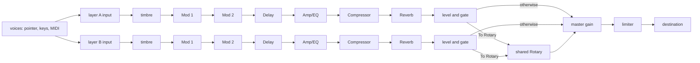

# Phase 2 implementation plan — Nord Stage 4 73 (stage-4-73)

Governing specs:

- `specs/nord-stage-4.visual.json` (surface geometry, section fractions, landmarks, forbidden hardware)
- `specs/nord-stage-4.piano.json` (six types, two layers, performance controls, sustain, fallback)
- `specs/nord-stage-4.effects.json` (six effect units per layer, shared Rotary, focus, bypass, signal order)

Also read: `TASK.md`, `prompts/stage2.md`, `specs/benchmark-phases.json` (Phase 2 contract), `specs/nord-stage-4.variants.json` (`stage-4-73`: 73 keys, 43 white, 30 black, E to E, hammer action), `reference/nord-stage-4-73.jpg`.

## Phase 2 hard gates

Quoted verbatim from `specs/benchmark-phases.json`, Phase 2:

- [x] Grand, Upright, and Electric are bundled recorded sample sets that are audibly distinct, work offline, and have complete redistributable provenance.
  - Met. Grand (Salamander V3, CC-BY-3.0), Upright (UprightPianoKW, CC0), and Electric (jRhodes3d, CC-BY-NC-4.0) are bundled, play offline, and render audibly different from one another (`instruments.render`, `pianoLibrary`). Provenance for every file is in `IMPLEMENTATION_DETAILS.json`. Caveat: the Electric licence is non-commercial (see Declared gaps).
- [x] Every functional piano and effect control measurably changes rendered audio and agrees with its panel feedback.
  - Met for every functional control. `controls.render` moves each functional piano and effect control and measures the change in rendered audio; `pianoControls.render`, `pedals.render`, and `effects.processing` cover the rest. The piano model dial is decorative and declared as such (see Declared gaps).
- [x] Each effect unit and type processes real audio with working bypass and dry/wet.
  - Met. `effects.processing` checks each unit and each listed type against bypass and the dry/wet mix on rendered audio, plus the delay feedback filter.
- [x] One AudioContext feeds layer buses, ordered effects, master gain/limiter, and one destination.
  - Met. `effects.graph` checks one AudioContext, per-layer buses, the ordered chain, master gain with limiter, one destination, and cleanup to baseline.
- [x] The Phase 1 surface, keybed, and input behavior remain regression-free.
  - Met. The Phase 1 tests are kept and pass. The Phase 1 surface measures unchanged in `evidence/stage2-visual-audit.md`.

## Phase 1 hard gates (inherited, still in force)

Quoted verbatim from `specs/benchmark-phases.json`, Phase 1:

- [x] The exact keybed count and range for the assigned variant are modeled and playable.
  - Met. `visual.key-count` and `interaction.keys`: 73 keys, E1 to E7 (MIDI 28 to 100), modelled and playable.
- [x] The complete visible control surface is present with the documented section geometry, and Program and Synth are the only primary OLED locations.
  - Met. `visual.section-layout` and `visual.control-inventory`. Program and Synth remain the only primary OLEDs.
- [x] The piano voice supports pointer, touch, computer keyboard, MIDI, velocity, release, sustain, polyphony, and cleanup.
  - Met. `piano.basic-note-lifecycle`, `piano.basic-inputs`, `piano.basic-sustain-polyphony`, and `piano.basic-status-cleanup`, all still passing.
- [x] Every visible panel control moves or presses accessibly but truthfully does nothing else.
  - Met. Panel controls outside the Phase 2 scope move or press and change presentation state only. The Program, Synth, Organ, and mod wheel controls say so (`interaction.decorative-controls`).
- [x] Canonical desktop and narrow captures are complete with a written visual audit.
  - Met for Phase 2. Captures and the written audit are in `evidence/stage2-*` (`evidence/stage2-visual-audit.md`). The Phase 1 captures stay in `evidence/stage1-*`.

## Shared completion gates

Quoted verbatim from `specs/benchmark-phases.json`:

- [x] All benchmark-owned and candidate-authored tests pass.
  - Met. `pnpm test` passes in `candidate/` (see the gate run in the final report).
- [x] The browser console contains no errors during the required interaction pass.
  - Met for the required interaction pass: 0 page errors and 0 console errors (`evidence/stage2-capture.json`). One environment warning about MIDI SysEx permission is not an app error.
- [x] Every claimed audio feature is connected to the audible signal graph.
  - Met. Every audio feature listed in `IMPLEMENTATION_DETAILS.json` is connected to the signal graph, and the rendered tests exercise it.
- [x] The latest phase preserves all inherited tests, visual evidence, and behavior.
  - Met. Phase 1 tests and evidence are kept, and Phase 2 adds to them.
- [x] IMPLEMENTATION_DETAILS.json accurately distinguishes recorded samples, generated buffers, and live synthesis.
  - Met. `IMPLEMENTATION_DETAILS.json` separates recorded samples (`sampleSources`), generated buffers (reverb impulses and the string-resonance sines), and live synthesis (fallback, Clav, Digital, Misc).
- [x] The evaluated source, build, and evidence match the sealed verification digest.
  - Met by construction: the evidence in `evidence/` was captured from the final `pnpm build` output. The sealed verification digest is the operator's to check.

Workspace requirements (`WORKSPACE.md`): `pnpm test`, `pnpm typecheck`, `pnpm lint`, and `pnpm build` inside `candidate/`. The operator then runs `pnpm bench seal claude-haiku-5-5` from the repository.

## Feature IDs (`tests/feature-matrix.json`)

Phase 1 IDs stay mapped: `visual.key-count`, `visual.section-layout`, `visual.control-inventory`, `interaction.keys`, `interaction.decorative-controls`, `accessibility.controls`, `piano.basic-note-lifecycle`, `piano.basic-inputs`, `piano.basic-sustain-polyphony`, `piano.basic-status-cleanup`, `regression.chassis`.

Phase 2 IDs: `piano.instrument-library`, `piano.layers`, `piano.velocity-controls`, `piano.pedals`, `piano.fallback`, `effects.graph`, `effects.routing`, `effects.processing`, `regression.phase1`.

`src/featureMatrix.test.ts` fails if any required ID lacks a real, non-empty test file.

## Sample provenance

Built by `tools/samples/build_piano_samples.py` from three upstream archives. The script is the provenance record. Hashes, licence texts, and file lists are in `IMPLEMENTATION_DETAILS.json` and `public/samples/licenses/`.

| Type | Set | Source | Licence | Files |
| --- | --- | --- | --- | --- |
| Grand | Salamander Grand V3 (Yamaha C5) | FreePats mirror of Alexander Holm's set, 44.1 kHz/16-bit | CC-BY-3.0 (attribution kept) | 100 MP3, 25 roots (D#1–D#7, every third semitone), 4 velocity layers, 10 s each |
| Upright | UprightPianoKW (Kawai upright) | FreePats, CC0 | CC0-1.0 | 66 MP3, 38 roots (A0–C8), soft and loud layers |
| Electric | 1977 Rhodes Mark I Stage 73 (jRhodes3d, Jeff Learman) | GitHub `jlearman/jRhodes3d-wav` at a886e6c, no-crossfade mono mapping | CC-BY-NC-4.0 (non-commercial; attribution kept) | 75 MP3, 15 roots (F1–C7), 5 velocity layers, 10 s each |
| Clav, Digital, Misc | Synthesized | Live synthesis, declared as such | n/a | n/a |

## Architecture

1. `src/audio/audioBoundary.ts`: the minimal Web Audio surface. The browser, the recording fake, and OfflineAudioContext all satisfy it.
2. `src/audio/voice.ts`, `pianoVoice.ts`, `sampleVoice.ts`, `synthVoices.ts`: the voice contract; the Phase 1 additive voice (now the labelled fallback); sample voices with unison copies; Clav, Digital, and Misc synthesis.
3. `src/audio/sampleLibrary.ts`, `pianoModels.ts`, `timbre.ts`, `stringResonance.ts`: manifests and zone selection; the six types; the Timbre filter; simulated sympathetic resonance.
4. `src/audio/effects/`: `slot.ts` (dry/wet bypass and branch selection; every switch ramps), `modulation.ts` (Mod 1, Mod 2), `ampEq.ts`, `delay.ts`, `dynamics.ts`, `reverb.ts`, `rotary.ts`, `types.ts`.
5. `src/audio/signalGraph.ts`: layer chains, the shared Rotary, master gain, and the limiter. One graph per AudioContext.
6. `src/engine/`: `pianoEngine.ts` (context lifecycle and status), `noteController.ts` (the Phase 1 note lifecycle, unchanged), `layerVoices.ts` (per-layer voice sink).
7. `src/instrument/pianoInstrument.ts`: two note controllers (one per layer), sustain routing, sample loading, and piano status. `usePianoInstrument.ts` is the React bridge.
8. `src/model/`: `hardware.ts` (panel inventory and the only presentation reducer, with per-layer effect keys `id@A` and `id@B`) and `audioSettings.ts` (a pure derivation from panel state to audio settings).

Within one layer, Reverb precedes the Rotary. Routing and level are gains that ramp. The graph builds once and only moves parameters.

## Decisions and declared choices

- **Piano type, model, timbre, touch, dyn comp, unison, soft release, and string res are section-wide.** The Layer A and Layer B buttons control on/off, level, and octave per layer. The focus buttons select which layer the effect panel edits. The manual does not put the piano type per layer, and the spec's layer controls do not include it.
- **Effects are per layer.** Layer focus carries through to effect focus. Group mode writes both layers. Global mode (Shift + On on Delay, Compressor, or Reverb) sets global mode for that unit: its settings apply to both layers. Shift + On does not switch the unit on; the On switch does that.
- **Layer effects ON** bypasses every unit at the graph.
- **SUSTPED** gates the sustain input for the whole piano section. Per-layer SUSTPED is not modelled.
- **Pitch stick with PSTICK** bends the piano ±2 semitones.
- **Rotary** is driven by Slow/Fast. The Rotary brake button stops the rotor (the spec's optional stop mode).
- **Master Level** scales the master gain. At the knob's default 0.7 it gives the Phase 1 gain of 0.3.
- **Level faders** taper (level squared).
- **Octave knobs** have three positions: the low third is −12, the middle is 0, and the top third is +12.
- **Amp type "To Rotary"** is EQ only, and the layer routes into the shared Rotary.
- **Visual changes** are declared in `evidence/stage2-visual-audit.md`.

## Declared gaps

- **Electric licence is non-commercial.** The jRhodes3d samples are CC BY-NC 4.0. That is redistributable with attribution, and the provenance is documented, but it may not be used commercially without the author's permission. The upstream LICENSE file and the SFZ header disagree (CC BY-NC vs "CC-SA-BY ... without share-alike or attribution"). This build follows the stricter LICENSE file.
- **Electric keys 97–100 shift up to about 4 semitones**, because the nearest root is C7 (MIDI 96). Keys 28 and 29 shift by 1 semitone.
- **Upright has 10 soft-only roots**, so loud strokes at those roots use the soft layer.
- **Grand and Electric are truncated at 10 seconds** with a 1.5-second fade-out, so sustain past about 10 seconds is silent. **Upright plays its full length** (5 to 8 seconds) with no loops. No set uses loop points; the Electric samples are unlooped upstream.
- **No pedal-down string samples and no pedal noise.** String Res is a simulation: sympathetic sines at held notes.
- **Soft and sostenuto pedals are not implemented.** Only SUSTPED sustain is.
- **Piano model dial is decorative.** Each type has one model, so the dial moves but changes nothing. The status line names the model.
- **Clav and Misc timbre steps** reuse the acoustic timbre steps as an approximation.
- **Delay tap tempo and master clock** are not implemented. Delay time is free, 60–1000 ms. Ping-pong is not implemented.
- **Per-type Variations, Reverb Chorale, and the delay feedback-loop effects** (excluded in the spec) are not implemented.
- **Organ, Synth, and Program** controls stay decorative and say so on the OLEDs. The mod wheel is decorative.

## Order of work

1. This plan.
2. Refactor the Phase 1 voice into the layer, bus, and master architecture, with input behaviour unchanged.
3. Piano types, sample sets, two layers, and performance controls.
4. Effect units in signal order, then focus, group, global, and panel bindings.
5. Rendered-audio tests, browser pass, visual regression against Phase 1, captures, and provenance.
