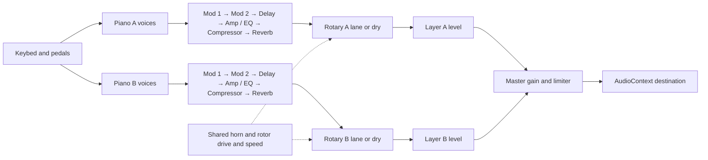

# Stage 4 73 implementation plan

1. Reconstruct the chassis, the six bands, and the E1–E7 hammer-action keybed from the variant entry and the product reference. The visual spec's updated photo measurements establish section boundaries.
2. Model each panel control with a stable ID, geometry, initial position, and accessible name. Keep panel presentation state separate from note input.
3. Route pointer, touch, mapped keyboard, and Web MIDI through an injectable note lifecycle. Ship one recorded piano voice with a labeled synthesis fallback.
4. Verify interaction and rendered audio with deterministic tests. Measure the rebuilt surface at both viewports and preserve the canonical captures, audit, and sample provenance.

## Phase 1 hard gates

- [ ] The exact keybed count and range for the assigned variant are modeled and playable.
- [ ] The complete visible control surface is present with the documented section geometry, and Program and Synth are the only primary OLED locations.
- [ ] The piano voice supports pointer, touch, computer keyboard, MIDI, velocity, release, sustain, polyphony, and cleanup.
- [ ] Every visible panel control moves or presses accessibly but truthfully does nothing else.
- [ ] Canonical desktop and narrow captures are complete with a written visual audit.

Assigned specs: `nord-stage-4.visual.json`, `nord-stage-4.piano.json`

## Phase 2 implementation

1. Preserve the inherited chassis, control positions, input bindings, tests, and captures for the Stage 4 73.
2. Introduce a persistent signal graph with two independently owned Piano layers. Keep input token and MIDI channel tracking at the shared keybed boundary.
3. Retain the two-dynamic Upright Piano KW bank. Cut stereo Salamander Grand recordings across the keyboard in minor thirds at five recorded dynamics. Cut the fifteen Rhodes Mark I roots from the pack, preserve the source loop points for runtime sustain, and derive its velocity response from gain and filtering. Record the exact pack path, root, recorded dynamic, processing, and source attribution for each bundled asset. Load banks locally on demand. Synthesize Clav, Digital, Misc, and a temporary fallback in memory.
4. Bind Piano and FX controls to layer settings, including tap tempo, shared Rotary, grouped and global units, and the master level. Keep unsupported gestures decorative. Use the existing Program OLED for focused Piano feedback.
5. Test the actual graph in an offline renderer and exercise the built instrument in Chromium. Compare the canonical captures with Phase 1 at both viewport sizes.

Delay feedback passes from the delay output through the selected filter and feedback gain back into the delay input.

## Phase 2 hard gates

- [ ] Grand, Upright, and Electric are bundled recorded sample sets that are audibly distinct, work offline, and have complete redistributable provenance.
- [ ] Every functional piano and effect control measurably changes rendered audio and agrees with its panel feedback.
- [ ] Each effect unit and type processes real audio with working bypass and dry/wet.
- [ ] One AudioContext feeds layer buses, ordered effects, master gain/limiter, and one destination.
- [ ] The Phase 1 surface, keybed, and input behavior remain regression-free.

Assigned specs: `nord-stage-4.visual.json`, `nord-stage-4.piano.json`, `nord-stage-4.effects.json`

The Phase 2 captures, visual comparison, and list of unsupported controls are in `evidence/stage2-visual-audit.md`. The sample paths, recorded dynamics, root notes, processing, copyright notices, and licenses are in `IMPLEMENTATION_DETAILS.json`.
